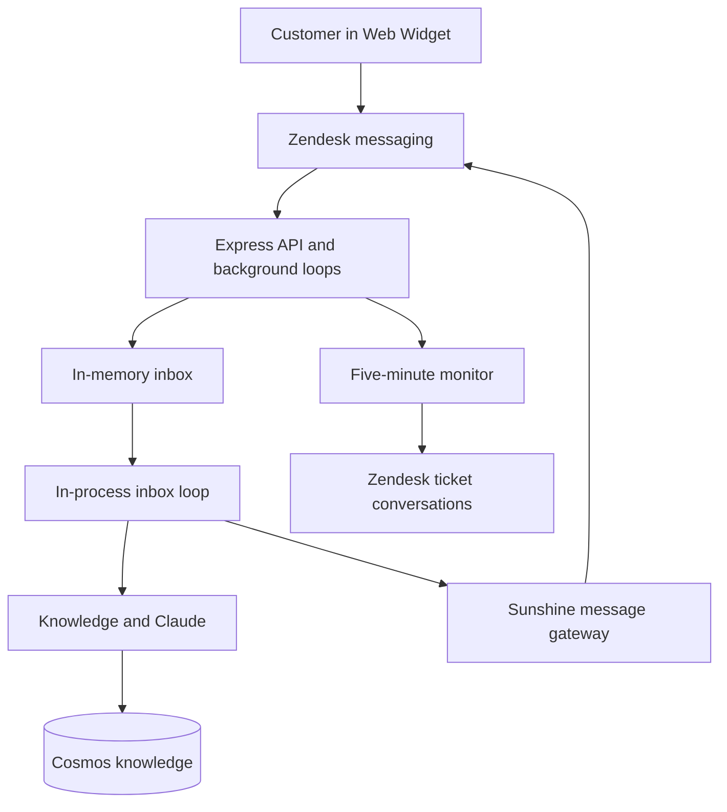
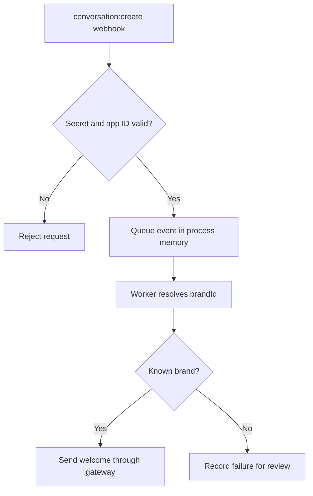
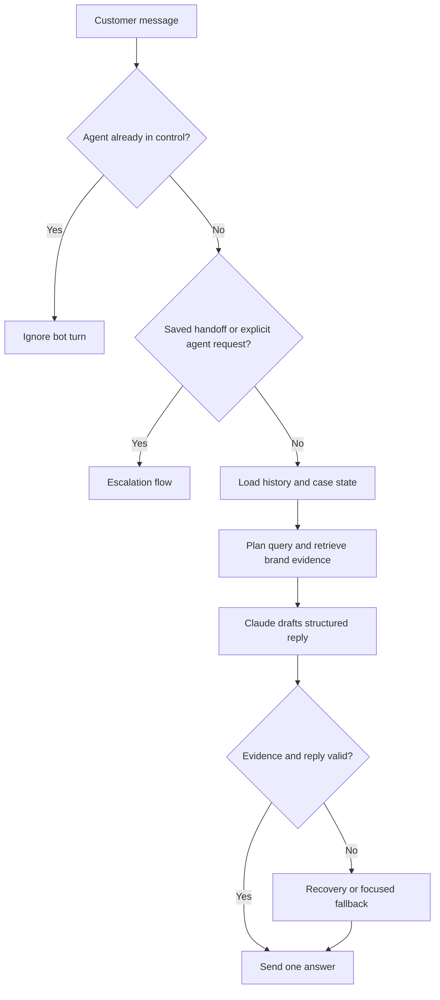
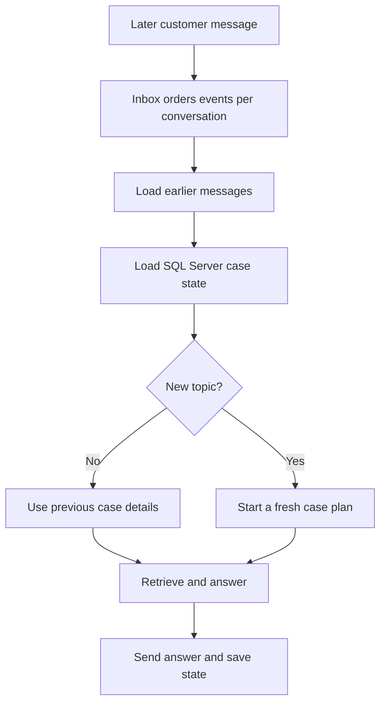
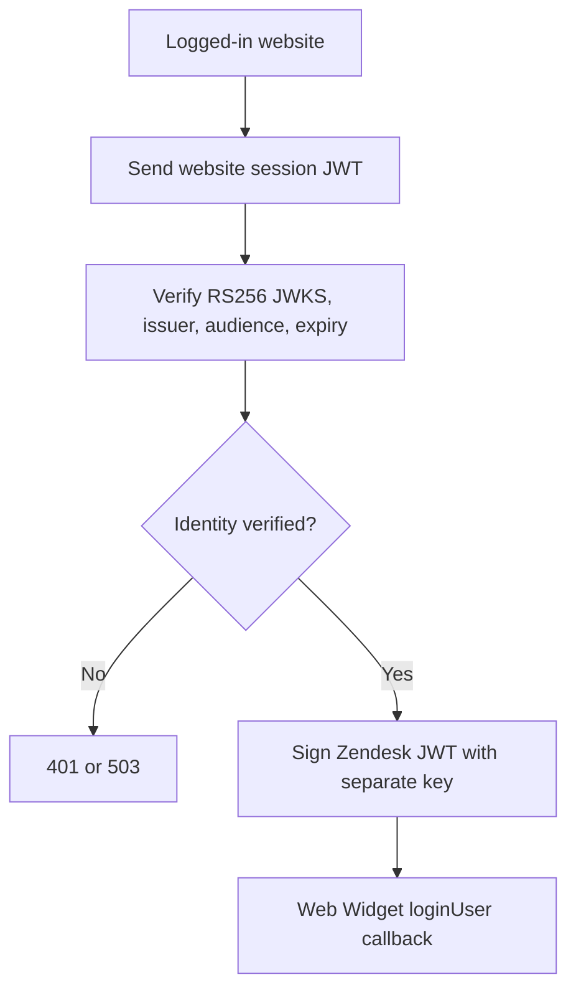
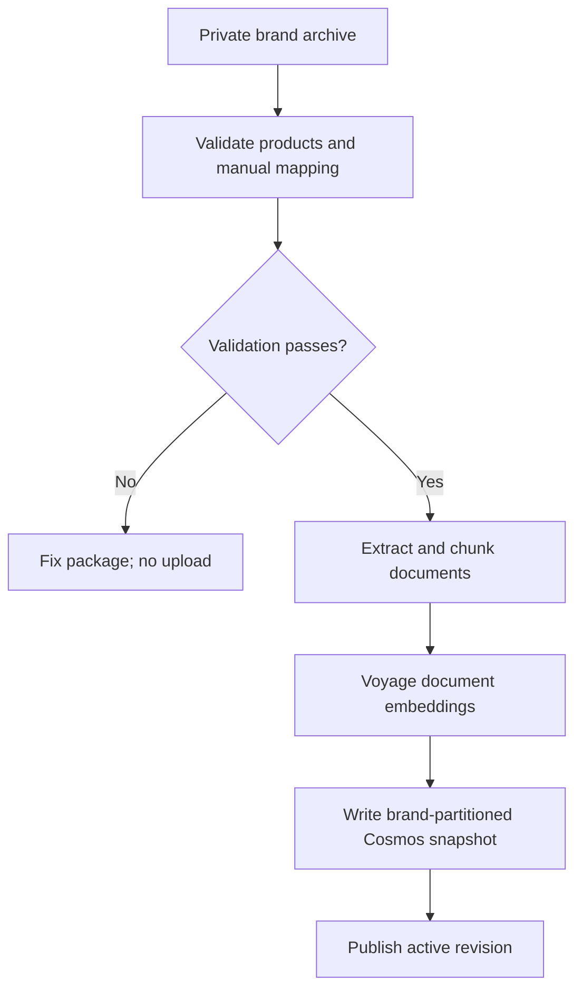
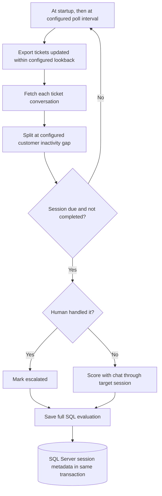
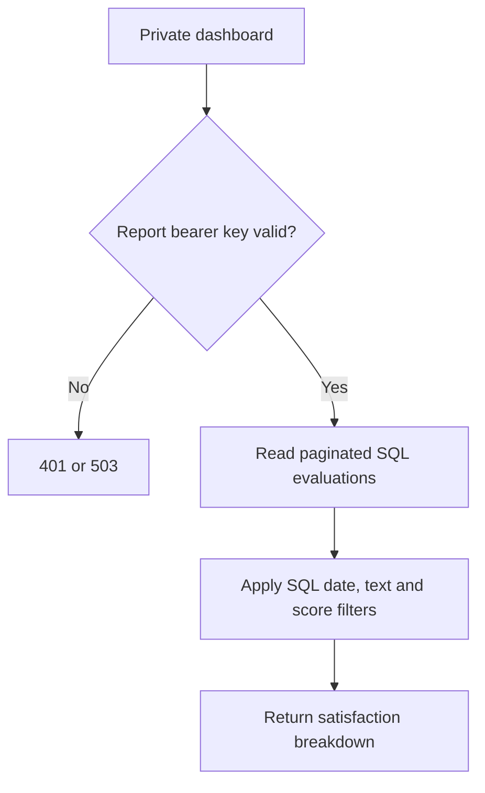
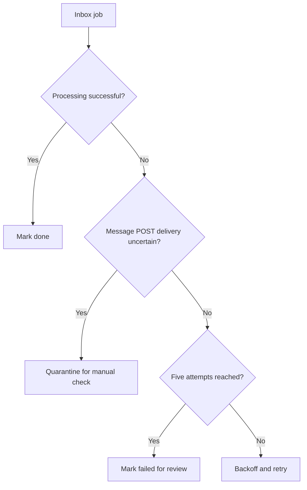

# Project flows by customer and operations case

## 1. Overall runtime

The API acknowledges events after they enter the current process's bounded memory queue. It then wakes the inbox loop in the same `npm start` process. Queued events and recent duplicate IDs are lost on restart; another app instance has a separate queue. The monitoring loop runs independently. A unique event key deduplicates redeliveries while that key remains in memory.

## 2. New conversation and welcome

The brand ID must match `WIDGET_ID_MR_BRAND` or `WIDGET_ID_COMFORT_ZONE`. Unknown brands never search a different brand's knowledge.

## 3. Normal question or FAQ

The question path does not send a progress message. The original retrieval, evidence-label validation and citation audit remain. Greetings and basic information requests bypass the escalation classifier when the heuristic identifies them. The answer model still runs for conversational turns. A generation timeout sends one operational fallback; a failed Sunshine POST is tracked by the inbox.

## 4. Customer follow-up in the same conversation

A follow-up such as “that did not work” can refer to a prior bot answer. Case state survives a web process restart. Customer-visible text is sent once per turn through the gateway.

## 5. Agent handoff and after-hours form

Durable state, context-aware acceptance, form validation, transfer reconciliation and latency are described in the single [Hinglish handoff guide](HANDOFF_FLOW.md).

## 6. Authenticated widget user

`sub` becomes `external_id`. The endpoint ignores the request body and only claims a verified email when the website supplies `email_verified: true`. Anonymous users can use the widget without calling this authenticated endpoint if Zendesk permits it.

## 7. Knowledge publication

Use `--validate-only` first. Ingestion is an explicit CLI action, never a web request or background startup task. The two bundled archives remain separate, and the vector dimension must match the embedding model output.

## 8. Configurable polling and customer sessions

A customer return before `MONITOR_SESSION_IDLE_HOURS` extends the current session. A return at or after that gap creates another session, even in the same ticket. The default gap is two hours and the default `MONITOR_LOOKBACK_HOURS` is five hours. `MONITOR_POLL_INTERVAL_MINUTES` controls polling, with a five-minute default. The evaluator sees the full earlier conversation through the target session, never future outcomes. A unique SQL session ID and an atomic evaluation/completion transaction prevent repeated LLM scoring. A complete, relevant answer is sufficient for satisfied without acknowledgement; silence alone is not. Only tickets updated within the configured lookback enter a poll.

## 9. Report and failure recovery

A network failure after Sunshine received a message cannot safely be retried as if it were definitely unsent. The `delivery_uncertain` status prevents an automatic duplicate while this process remains alive. See `OPERATIONS.md` for local queue diagnostics and recovery guidance.
